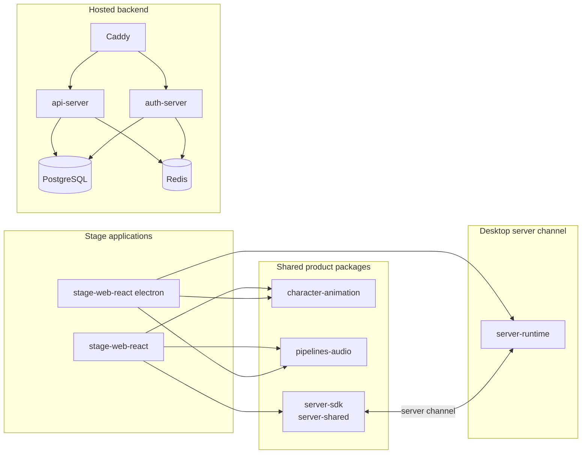

<picture>
  <source
    width="100%"
    srcset="./docs/assets/banner-dark-1280x640.avif"
    media="(prefers-color-scheme: dark)"
  />
  <source
    width="100%"
    srcset="./docs/assets/banner-light-1280x640.avif"
    media="(prefers-color-scheme: light), (prefers-color-scheme: no-preference)"
  />
  
</picture>

<h1 align="center">aipets</h1>

<p align="center">A talking digital pet rendered with transparent video clips.</p>

<p align="center">
  [<a href="./README.md">English</a>] [<a href="./docs/README.zh-CN.md">简体中文</a>]
</p>

> [!NOTE]
>
> This repository renders a virtual character with transparent video clips and does not use Live2D, VRM, or MMD.
>
> The project keeps the browser app and the Electron desktop app. It drops the mobile app, the game integrations,
> and most translation locales. Read [Range](#range) for the full decision table.

## What this project does

A digital pet lives on your screen and talks with you. A language model writes the reply, a speech model speaks
it, and a video player shows the matching body animation.

The interesting part is the animation pipeline. Every visible action is a clip. A session decides which clip
plays next. A crossfade player swaps between two video elements so the pet never freezes on a cut.

## Range

This table is the agreed scope of the project. The `Status` column tells what this repository keeps.

| Capability | Status | Detail |
| --- | --- | --- |
| Web app | Keep | `apps/stage-web-react`. React, Vite, UnoCSS. |
| Desktop app | Adopt | The `electron/` shell of `apps/stage-web-react`, packaged with electron-builder. |
| Mobile app | Removed | `apps/stage-pocket` is deleted. |
| Brain: chat channels | Trim | No Telegram, no Discord, no X. Their packages are deleted. The Satori adapter `integrations/satori-bot` is deleted too. |
| Brain: memory | Adopt | In-browser DuckDB WASM and `pglite`, plus the Alaya memory layer. |
| Brain: local inference | Adopt | WebGPU inference in the browser. Work in progress. |
| Ears | Adopt | Audio input, speech recognition, and voice activity detection. |
| Mouth | Adopt | Multi-provider speech synthesis. |
| Body | Drop | Live2D, VRM, MMD, Spine, and Tachie are out of scope. |
| Body: replacement | Adopt | Transparent video clips driven by `packages/character-animation`. |
| LLM providers | Trim | Domestic providers, OpenAI, and Claude only. |
| Plugin system | Adopt | `packages/plugin-sdk`, the plugin protocol, and the chess game plugin. |
| MCP | Adopt | Model Context Protocol servers. |
| Backend | Adopt | `server/` and the hosted API. |
| Input devices | Adopt | Gamepad and DualSense drivers. |
| Desktop native | Adopt | Native window and screen capture helpers. |
| Accounts and sign-in | Removed | `apps/ui-server-auth` is deleted. |
| Internationalization | Trim | Chinese and English only. |
| `apps/component-calling` | Removed | The experiment is deleted. |
| Package scope | Keep | npm packages stay under `@proj-aipets/*`. Only the project name changes. |

## Architecture



### The animation stack

Four layers own the animation. Each layer talks to the one below it.

| Layer | Path | Job |
| --- | --- | --- |
| Session state machine | `packages/character-animation/src/session.ts` | Holds the current state: `ambient`, `waiting`, `acting`, `speaking`. |
| Animation controller | `apps/stage-web-react/src/animation/session-controller.ts` | Turns state and events into a list of commands. |
| Sequence runners | `apps/stage-web-react/src/animation/waiting-sequence.ts`, `packages/character-animation/src/sequence.ts` | Walk a chain of clips and wait for each `ended` event. |
| Crossfade player | `apps/stage-web-react/src/animation/video-player.ts` | Plays two video elements and crossfades between them. |

Ambient playback uses a pure duration model. The program holds phases with `durationMs`. The controller adds the
durations, then resolves the active phase from `elapsed % total`. No timer drives the loop, so a dropped frame
cannot drift the phase.

## Development

```shell
pnpm i
pnpm dev:web
```

### Web app

```shell
pnpm dev:web
```

### Desktop app

```shell
pnpm -F @proj-aipets/stage-web-react dev       # Vite dev server
pnpm -F @proj-aipets/stage-web-react electron  # Electron window on the dev server
```

Build the Windows installer:

```shell
pnpm -F @proj-aipets/stage-web-react electron:dist
```

The installer is written to `apps/stage-web-react/release/`. That folder is not committed.

### Backend

```shell
pnpm dev:backend
```

### Checks

```shell
pnpm -F @proj-aipets/stage-web-react typecheck
pnpm -F @proj-aipets/character-animation exec vitest run
pnpm lint
```

## Supported LLM providers (powered by [xsai](https://github.com/moeru-ai/xsai))

This project keeps a short list. A generic OpenAI-compatible endpoint still works for anything else.

- [x] [OpenAI](https://platform.openai.com/docs/guides/gpt/chat-completions-api)
  - [x] [Azure OpenAI API](https://learn.microsoft.com/en-us/azure/ai-services/openai/reference)
- [x] [Anthropic Claude](https://anthropic.com)
- [x] [DeepSeek](https://www.deepseek.com/)
- [x] [Qwen](https://help.aliyun.com/document_detail/2400395.html)
- [x] [Zhipu](https://bigmodel.cn)
- [x] [SiliconFlow](https://cloud.siliconflow.cn/i/rKXmRobW)
- [x] [Stepfun](https://platform.stepfun.com/)
- [x] [Baichuan](https://platform.baichuan-ai.com)
- [x] [Minimax](https://api.minimax.chat/)
- [x] [Moonshot AI](https://platform.moonshot.cn/)
- [x] [ModelScope](https://modelscope.cn/docs/model-service/API-Inference/intro)
- [x] [Tencent Cloud](https://cloud.tencent.com/document/product/1729)
- [x] [Xiaomi Mimo](https://platform.xiaomimimo.com)
- [ ] [Volcano Engine](https://www.volcengine.com/) (PR welcome)
- [ ] [Sparks](https://www.xfyun.cn/doc/spark/Web.html) (PR welcome)

## Documentation

- [docs/README.md](./docs/README.md): document index
- [docs/ai/animation-video-stage-plan.md](./docs/ai/animation-video-stage-plan.md): the transparent video stage plan
- [AGENTS.md](./AGENTS.md): rules for agent and contributor work
- [DESIGN.md](./DESIGN.md): UI design guide
- [CONTRIBUTING.md](./.github/CONTRIBUTING.md): contribution guide

## License

MIT. See [LICENSE](./LICENSE).

## Acknowledgements

The animation core, the stage packages, the server channel, and the design language build on these projects.

- [Reka UI](https://github.com/unovue/reka-ui): the headless UI base behind `packages/ui`
- [`xsai`](https://github.com/moeru-ai/xsai): the LLM and model client
- [pixiv/ChatVRM](https://github.com/pixiv/ChatVRM) and [josephrocca/ChatVRM-js](https://github.com/josephrocca/ChatVRM-js)
- UI and style inspiration: [Cookard](https://store.steampowered.com/app/2919650/Cookard/),
  [UNBEATABLE](https://store.steampowered.com/app/2240620/UNBEATABLE/), and
  [Sensei! I like you so much!](https://store.steampowered.com/app/2957700/_/)
