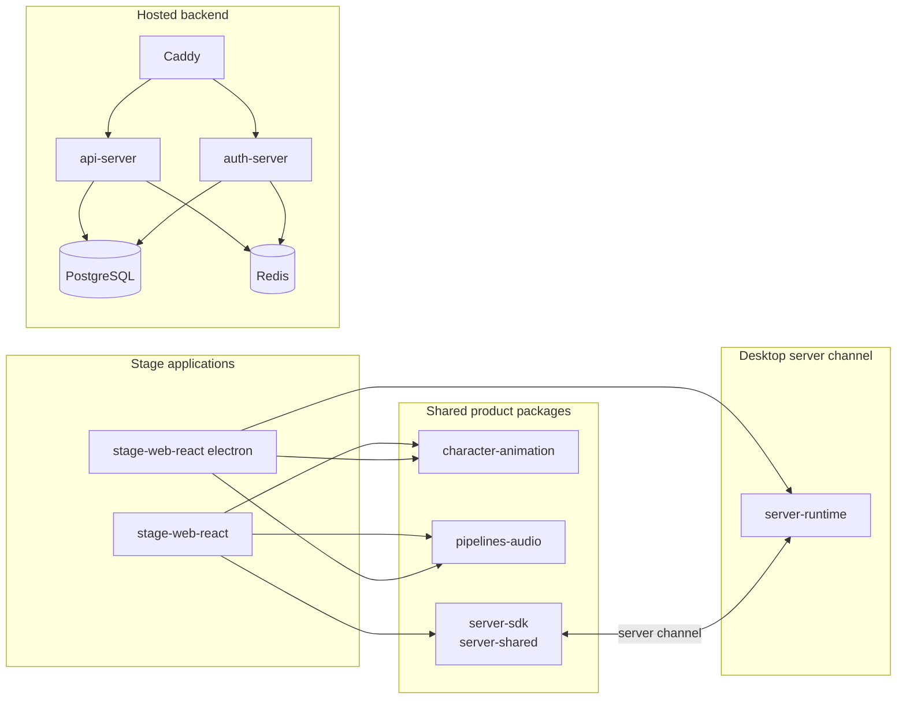

<picture>
  <source
    width="100%"
    srcset="./assets/banner-dark-1280x640.avif"
    media="(prefers-color-scheme: dark)"
  />
  <source
    width="100%"
    srcset="./assets/banner-light-1280x640.avif"
    media="(prefers-color-scheme: light), (prefers-color-scheme: no-preference)"
  />
  
</picture>

<h1 align="center">aipets</h1>

<p align="center">用透明视频片段驱动的会说话的数字宠物。</p>

<p align="center">
  [<a href="./README.md">English</a>] [<a href="./README.zh-CN.md">简体中文</a>]
</p>

> [!NOTE]
>
> 本仓库用透明视频片段渲染虚拟角色的身体，不使用 Live2D、VRM 或 MMD。
>
> 本仓库保留网页端与 Electron 桌面端，丢弃移动端、游戏集成与大多数翻译语言。完整的取舍见
> [范围](#范围)。

## 这个项目做什么

一个数字宠物住在你的屏幕上，并和你说话。大语言模型写出回复，语音模型把回复念出来，视频播放器显示
对应的身体动画。

真正有内容的部分是动画链路。每一个可见动作都是一个片段（clip）。会话决定下一个播哪个片段。交叉淡入
播放器在两个 video 元素之间切换，所以宠物不会卡在切换的瞬间。

## 范围

下表是本仓库约定的范围。`状态` 列说明本仓库的取舍。

| 能力 | 状态 | 说明 |
| --- | --- | --- |
| 网页端 | 保留 | `apps/stage-web-react`。React、Vite、UnoCSS。 |
| 桌面端 | 接入 | `apps/stage-web-react` 的 `electron/` 外壳，用 electron-builder 打包。 |
| 移动端 | 已移除 | `apps/stage-pocket` 已删除。 |
| 大脑：聊天渠道 | 裁剪 | 不做 Telegram、Discord、X，对应包已删除。Satori 适配器 `integrations/satori-bot` 也已删除。 |
| 大脑：记忆 | 接入 | 纯浏览器 DuckDB WASM 与 `pglite`，以及 Alaya 记忆层。 |
| 大脑：本地推理 | 接入 | 浏览器内 WebGPU 推理，施工中。 |
| 耳朵 | 接入 | 音频输入、语音识别、语音活动检测。 |
| 嘴巴 | 接入 | 多提供商语音合成。 |
| 身体 | 不接入 | Live2D、VRM、MMD、Spine、Tachie 都不在范围内。 |
| 身体：替代方案 | 接入 | 透明视频片段，由 `packages/character-animation` 驱动。 |
| LLM 提供商 | 裁剪 | 只保留国内厂商、OpenAI 与 Claude。 |
| 插件系统 | 接入 | `packages/plugin-sdk`、插件协议与国际象棋游戏插件。 |
| MCP | 接入 | Model Context Protocol 服务。 |
| 后端 | 接入 | `server/` 与托管 API。 |
| 输入设备 | 接入 | 手柄与 DualSense 驱动。 |
| 桌面原生 | 接入 | 原生窗口与屏幕捕获能力。 |
| 国际化 | 裁剪 | 只保留中文与英文。 |
| 登录与账号 | 已移除 | `apps/ui-server-auth` 已删除。 |
| `apps/component-calling` | 已移除 | 实验应用已删除。 |
| 包作用域 | 保留 | npm 包保持 `@proj-aipets/*`，只改项目名。 |

## 架构



### 动画分层

动画由四层负责。每一层只和它的下一层通信。

| 层 | 路径 | 职责 |
| --- | --- | --- |
| 会话状态机 | `packages/character-animation/src/session.ts` | 保存当前状态：`ambient`、`waiting`、`acting`、`speaking`。 |
| 动画控制器 | `apps/stage-web-react/src/animation/session-controller.ts` | 把状态与事件变成一组命令。 |
| 序列执行器 | `apps/stage-web-react/src/animation/waiting-sequence.ts`、`packages/character-animation/src/sequence.ts` | 依次播放片段链，并等每个 `ended` 事件。 |
| 交叉淡入播放器 | `apps/stage-web-react/src/animation/video-player.ts` | 播放两个 video 元素，并在它们之间交叉淡入。 |

环境（ambient）播放使用纯时长模型。编排里保存带 `durationMs` 的阶段。控制器累加时长，再用
`elapsed % total` 求当前阶段。没有定时器驱动循环，所以丢帧不会让阶段漂移。

## 开发

```shell
pnpm i
pnpm dev:web
```

### 网页端

```shell
pnpm dev:web
```

### 桌面端

```shell
pnpm -F @proj-aipets/stage-web-react dev       # 启动 Vite 开发服务器
pnpm -F @proj-aipets/stage-web-react electron  # 在开发服务器上打开 Electron 窗口
```

构建 Windows 安装包：

```shell
pnpm -F @proj-aipets/stage-web-react electron:dist
```

安装包写入 `apps/stage-web-react/release/`，该目录不入库。

### 后端

```shell
pnpm dev:backend
```

### 检查

```shell
pnpm -F @proj-aipets/stage-web-react typecheck
pnpm -F @proj-aipets/character-animation exec vitest run
pnpm lint
```

## 支持的 LLM 提供商（由 [xsai](https://github.com/moeru-ai/xsai) 驱动）

本仓库只保留一份短名单。其他模型仍可通过通用的 OpenAI 兼容接口接入。

- [x] [OpenAI](https://platform.openai.com/docs/guides/gpt/chat-completions-api)
  - [x] [Azure OpenAI API](https://learn.microsoft.com/en-us/azure/ai-services/openai/reference)
- [x] [Anthropic Claude](https://anthropic.com)
- [x] [DeepSeek](https://www.deepseek.com/)
- [x] [通义千问](https://help.aliyun.com/document_detail/2400395.html)
- [x] [智谱](https://bigmodel.cn)
- [x] [硅基流动](https://cloud.siliconflow.cn/i/rKXmRobW)
- [x] [阶跃星辰](https://platform.stepfun.com/)
- [x] [百川](https://platform.baichuan-ai.com)
- [x] [Minimax](https://api.minimax.chat/)
- [x] [月之暗面](https://platform.moonshot.cn/)
- [x] [魔搭](https://modelscope.cn/docs/model-service/API-Inference/intro)
- [x] [腾讯混元](https://cloud.tencent.com/document/product/1729)
- [x] [小米 Mimo](https://platform.xiaomimimo.com)
- [ ] [火山引擎豆包](https://www.volcengine.com/)（欢迎提交 PR）
- [ ] [讯飞星火](https://www.xfyun.cn/doc/spark/Web.html)（欢迎提交 PR）

## 文档

- [docs/README.md](./docs/README.md)：文档索引
- [docs/ai/animation-video-stage-plan.md](./docs/ai/animation-video-stage-plan.md)：透明视频舞台方案
- [AGENTS.md](./AGENTS.md)：智能体与贡献者的工作规则
- [DESIGN.md](./DESIGN.md)：界面设计指南
- [CONTRIBUTING.md](./.github/CONTRIBUTING.md)：贡献指南

## 许可证

MIT，见 [LICENSE](./LICENSE)。

## 致谢

动画内核、stage 系列包、服务端通道与设计语言基于以下项目。

- [Reka UI](https://github.com/unovue/reka-ui)：`packages/ui` 所用的无头界面基础
- [`xsai`](https://github.com/moeru-ai/xsai)：LLM 与模型客户端
- [pixiv/ChatVRM](https://github.com/pixiv/ChatVRM) 与 [josephrocca/ChatVRM-js](https://github.com/josephrocca/ChatVRM-js)
- 界面与风格灵感：[Cookard](https://store.steampowered.com/app/2919650/Cookard/)、
  [UNBEATABLE](https://store.steampowered.com/app/2240620/UNBEATABLE/)、
  [Sensei! I like you so much!](https://store.steampowered.com/app/2957700/_/)
